<h1 align="center">Factuality Auditor</h1>

<p align="center">
  <em>Hallucination detection built from scratch: extract atomic claims, verify them against a knowledge base, and produce a calibrated factuality judgment.</em>
</p>

<p align="center">
  <a href="https://github.com/adeoluo/factuality-auditor/actions/workflows/ci.yml"></a>
  
  
  
  
  
</p>

---

## Motivation

A language model's answer can be fluent and wrong. Catching that requires checking the
answer's **individual factual claims** against trusted knowledge, and, just as importantly,
knowing **how much to trust the check itself**. This project builds a factuality auditor
**from scratch**: it decomposes an answer into atomic claims, verifies each against a
knowledge base, judges the whole answer, and reports a **calibrated confidence** so a
downstream system can act on a probability rather than a bare label. It is offline,
deterministic, and has **zero runtime dependencies**.

## Architecture

<p align="center">
  
</p>

An answer is split into claims, each claim is verified against the knowledge base
(supported, refuted, or unverifiable), the verdicts are aggregated into a document judgment,
and the confidence is checked against outcomes by a calibration metric. See the
[ADRs](docs/adr/) for the key design choices.

## How verification works

The knowledge base holds **functional facts**: a subject and relation fix a single correct
object (a country has one capital, an element one symbol). This is what lets the auditor
**refute** a claim rather than merely fail to support it:

- **Supported** - the base holds exactly the claimed fact.
- **Refuted** - the base holds the same subject and relation but a **different** object, so
  the claim contradicts known fact.
- **Unverifiable** - the base has nothing on that subject, so the auditor **abstains** with
  low confidence instead of guessing.

## Results

> Reproduce with `python -m factuality_auditor evaluate`. A labeled set of fifteen answers
> spanning supported, refutable-hallucinated, and unverifiable claims.

**Hallucination detection**

| Method | precision | recall | F1 |
|---|---:|---:|---:|
| **auditor** | **1.000** | **0.714** | **0.833** |
| trust-everything baseline | 0.000 | 0.000 | 0.000 |

**Confidence calibration** (expected calibration error, lower is better)

| Method | expected calibration error |
|---|---:|
| **auditor confidence** | **0.037** |
| overconfident baseline | 0.123 |

The auditor flags **every refutable hallucination with perfect precision**. It misses only
hallucinations whose subject lies outside its knowledge base, where it correctly **abstains
with low confidence** rather than guessing. That honesty is exactly what the calibration
number captures: the auditor's confidence tracks its accuracy (error 0.037), whereas an
overconfident baseline that always reports high confidence is far less trustworthy (0.123).

### Scale

To check that the audit pipeline holds up at volume, `benchmarks/scale.py` runs
`audit_document` over deterministically generated answer sets at growing sizes, auditing
each answer against a same-sized knowledge base of capital-of facts. Half of every batch
is factual and half is hallucinated (wrong country), so detection precision and recall
are measured against the known labels, while wall-clock time, throughput, and peak memory
(via the standard-library `tracemalloc`) are recorded. The data is synthetic and the
numbers are environment-specific, but the shape is the point: throughput stays roughly
flat and memory grows linearly with the workload, while detection stays exact on this
clean synthetic set.

| Answers | Wall-clock (s) | Throughput (answers/s) | Peak memory (MiB) | Precision | Recall |
|---:|---:|---:|---:|---:|---:|
| 1,000 | 0.063 | ~16,000 | 0.57 | 1.000 | 1.000 |
| 4,000 | 0.265 | ~15,100 | 2.12 | 1.000 | 1.000 |
| 16,000 | 1.071 | ~14,900 | 8.95 | 1.000 | 1.000 |
| 32,000 | 2.460 | ~13,000 | 18.35 | 1.000 | 1.000 |

Reproduce with `uv run python benchmarks/scale.py`.

## Demonstration

```text
$ python -m factuality_auditor audit "Paris is the capital of Germany."
judgment: HALLUCINATED (confidence 0.97)
claims: 0 supported, 1 refuted, 0 unverifiable
  [     refuted] paris / capital_of / germany (known: france)
```

## Quickstart

```bash
git clone https://github.com/adeoluo/factuality-auditor.git && cd factuality-auditor
make setup                    # install dev tooling + pre-commit hooks
make all                      # lint + type-check + test

python -m factuality_auditor evaluate                   # detection + calibration
python -m factuality_auditor audit "Mars has 5 moons."
```

Use the library directly:

```python
from factuality_auditor import KnowledgeBase, audit_document

knowledge = KnowledgeBase.from_triples([("Paris", "capital_of", "France")])
audit = audit_document("Paris is the capital of Germany.", knowledge)
print(audit.is_hallucinated, round(audit.confidence, 2))
```

## Components

- **extraction** - rule-based mapping of sentences to (subject, relation, object) claims.
- **knowledge** - a functional-fact knowledge base supporting contradiction checks.
- **verification** - supported, refuted, or unverifiable, each with a confidence.
- **scoring** - aggregate claims into a document judgment and a calibrated probability.
- **calibration** - reliability bins and expected calibration error.
- **evaluation** - detection and calibration on the labeled set.

## Design decisions

- **A functional knowledge base.** Functional relations are what make refutation possible, so
  the auditor can say a claim is wrong, not just unproven.
  ([ADR-0002](docs/adr/0002-functional-knowledge-base.md))
- **Calibrated confidence and abstention.** The auditor is confident on verifiable claims and
  deliberately uncertain on claims outside its knowledge, which calibration rewards.
  ([ADR-0003](docs/adr/0003-calibrated-confidence.md))

## Running the service

A dependency-free HTTP service exposes the auditor as a production-style JSON API:

```bash
python -m factuality_auditor serve --port 8000

curl localhost:8000/health
curl -s -X POST localhost:8000/audit -d '{"text": "Paris is the capital of Germany."}'
```

`GET /health` reports the knowledge-base size; `POST /audit` returns the judgment, the
calibrated confidence, claim counts, and per-claim verdicts with contradicting evidence.
See the [operations guide](docs/OPERATIONS.md) for the service contract and constraints.
The service also exposes `GET /ready` (readiness) and `GET /metrics` (per-route request, error, and latency metrics in Prometheus text format).

## Performance and reliability

A deterministic micro-benchmark (`uv run python benchmarks/benchmark.py`) audits a thousand
answers against a thousand-fact knowledge base end to end (extraction, verification, and
scoring), reporting throughput. On a laptop the auditor sustains tens of thousands of answers
per second, because verification is an indexed lookup rather than a model call.

A production-style stress benchmark (`uv run python benchmarks/stress.py`) drives the full
audit handler under concurrent load and reports throughput with p50, p95, and p99 latency,
confirming flat, sub-millisecond latency because verification is an indexed lookup. The
scaling path and tradeoffs are in [docs/SCALING.md](docs/SCALING.md), and a full audit
walk-through (including the honest-abstention case) is in the [case study](docs/CASE_STUDY.md).

## Responsible AI

- **Model card:** [docs/MODEL_CARD.md](docs/MODEL_CARD.md)
- **Data card:** [docs/DATA_CARD.md](docs/DATA_CARD.md)
- **Threat model:** [docs/THREAT_MODEL.md](docs/THREAT_MODEL.md)

## Limitations

- Extraction is rule-based; messy prose needs a model-backed extractor (a deliberate boundary
  to stay from-scratch and dependency-free).
- The knowledge base is small and covers five functional relations; recall is bounded by its
  coverage, which the calibrated confidence makes explicit.
- The bundled set is a demonstration, not a competitive benchmark.

## Roadmap

- [ ] A model-backed claim extractor behind the existing interface
- [ ] Retrieval-backed verification over a document corpus
- [ ] Temperature scaling and a learned calibrator over claim features

## License

[MIT](LICENSE). Part of an artificial intelligence engineering portfolio by
[adeoluo](https://github.com/adeoluo).
